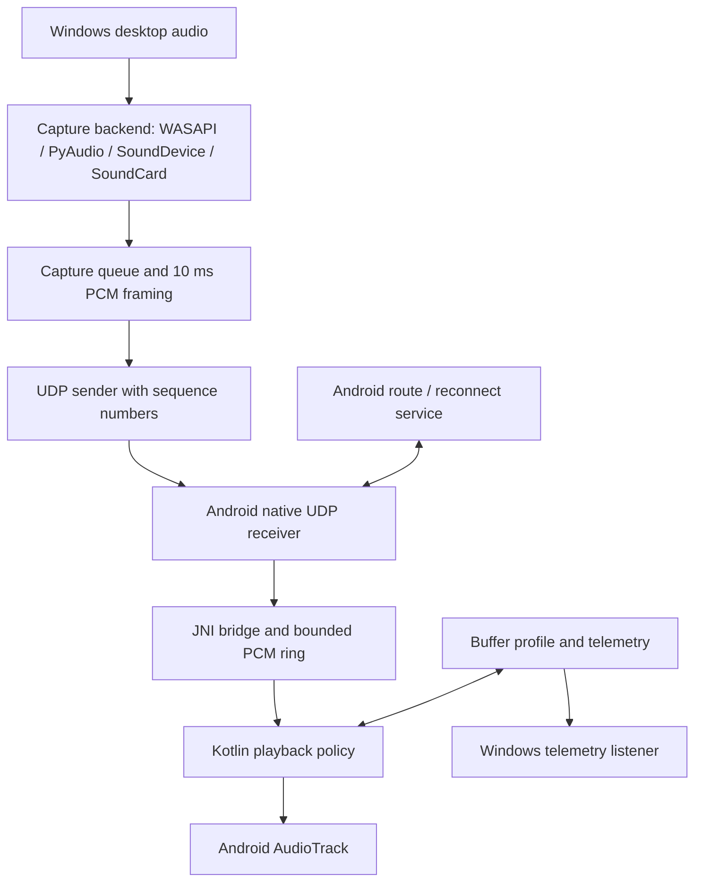

# LAN_AUDIO_STREAMER

**Android client + Windows desktop audio sender**  
**Project author:** Mohammed Ashfaq  
**Status:** Active prototype / engineering portfolio project

Wi-Fi Audio Speaker streams desktop PC audio to an Android device over a local network. The project combines an Android foreground service, a JNI/C++ UDP receiver, and a Windows desktop sender with multiple audio-capture backends.

This repository is a curated source snapshot assembled from the project files available on 7 November 2026. It is intended for technical review and portfolio presentation. **It is not yet a complete, directly buildable Android Studio project**: the original Gradle project files, wrapper, manifest, and some Android resources were not present in the supplied workspace. See [Build readiness](#build-readiness).

## What the project demonstrates

- Android application architecture using Kotlin, Activities, a foreground Service, AudioTrack, and network callbacks.
- JNI integration between Kotlin and native C++.
- UDP audio transport using fixed 10 ms PCM frames (48 kHz, mono, signed 16-bit samples).
- Windows desktop audio capture and a Qt-based control interface written in Python.
- Multiple capture backends and Windows media-session / master-mute integration where supported.
- Network-route discovery and recovery logic for home Wi-Fi, PC hotspot, mobile hotspot, and USB tethering.
- Separate playback policies for Golden Ultra Low, Low, Medium, High, and a Custom adaptive experiment.
- Instrumentation for packet drops, native-ring timeouts, AudioTrack underruns, queue pressure, RTT, and jitter.

## Architecture



More detail is in [docs/ARCHITECTURE.md](docs/ARCHITECTURE.md).

## Repository layout

```text
android-client/
  source-snapshot/             Curated Kotlin, JNI/C++, CMake, and layout sources
  experiments/custom-adaptive-v1/  Isolated Custom-engine candidate (not release-validated)
windows-server/
  wifi_audio_server.py         Windows sender and control UI
  requirements.txt             Python dependencies

docs/
  ARCHITECTURE.md              Component responsibilities and data flow
  ENGINEERING_STATUS.md        Implemented work and known limitations
  TEST_MATRIX.md               Device / transport validation plan
  PUBLISHING.md                GitHub and GitLab publishing steps
```

## Buffer modes

| Mode | Intended priority | Engineering status |
|---|---|---|
| Golden Ultra Low | Minimum latency with aggressive stale-audio control | Dedicated code path; device/network edge cases remain under investigation |
| Low | Low delay with bounded backlog correction | Dedicated code path; device testing continues |
| Medium | Balanced delay and jitter tolerance | Dedicated code path in the source snapshot |
| High | Audio continuity during longer delivery gaps | Dedicated continuity-oriented code path |
| Custom | User-selected target with adaptive receiver policy | Experimental candidate in `android-client/experiments/custom-adaptive-v1/`; physical-device validation pending |

The Custom experiment is intentionally kept separate from the baseline source snapshot. Do not overwrite the baseline files with the experiment until the candidate has been integrated, built, and tested on devices.

## Network transports

The application contains route-detection / recovery logic intended for:

1. Home Wi-Fi (2.4 GHz and 5 GHz networks)
2. Windows PC hotspot
3. Android mobile hotspot
4. USB tethering

These are supported design targets, not a claim that every combination is already proven loss-free. Wireless interference, router airtime, USB/RNDIS drivers, operating-system scheduling, and device audio hardware still affect real-time performance.

## Build readiness

The repository currently contains source snapshots, not the complete Android Studio project. The following original project items were not available in the workspace and are therefore not fabricated here:

- `settings.gradle` / `settings.gradle.kts`
- Root and app-module `build.gradle` files
- Gradle wrapper (`gradlew`, `gradle/wrapper/*`)
- `AndroidManifest.xml`
- Complete `res/values`, drawable, notification, and other resource directories
- Complete Android packaging configuration and signing setup

The native `CMakeLists.txt` and its three C++ translation units are included, but the full Android Gradle/NDK build has not been run against this snapshot. Obtain the original Android Studio project root before attempting an APK/AAB build.

For the Windows sender, see [windows-server/README.md](windows-server/README.md).

## Validation and honesty about results

The work has been debugged using Android Logcat and Windows server telemetry on multiple physical Android devices. Previous runs confirmed profile selection and AudioTrack reconstruction for Golden Ultra Low and Low on tested devices. They also exposed network jitter, ring timeouts, playback underruns, and capture-queue behaviour that still need tuning.

The latest Custom adaptive candidate has static policy checks and source-level validation, but **has not been confirmed by a complete Android Gradle/NDK build or a physical-device playback run**. See [docs/ENGINEERING_STATUS.md](docs/ENGINEERING_STATUS.md) and [docs/TEST_MATRIX.md](docs/TEST_MATRIX.md).

Raw device logs, local screenshots, IP addresses from test sessions, personal contact details, APK signing keys, and local IDE settings are intentionally excluded from this public portfolio snapshot.

## Development approach

This is a hands-on personal project focused on audio streaming, Android services, native interop, desktop capture, network reliability, and iterative device testing. AI-assisted coding and review were used during development; design choices, assumptions, known issues, and validation limits are documented rather than presenting untested work as production-ready.

## Contact

For project discussion, use the contact details supplied separately with the job application. No personal phone number or email address is embedded in this repository.
